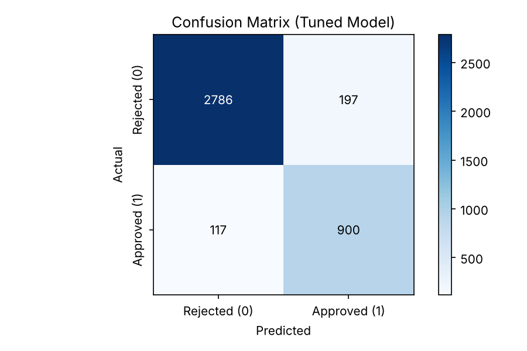
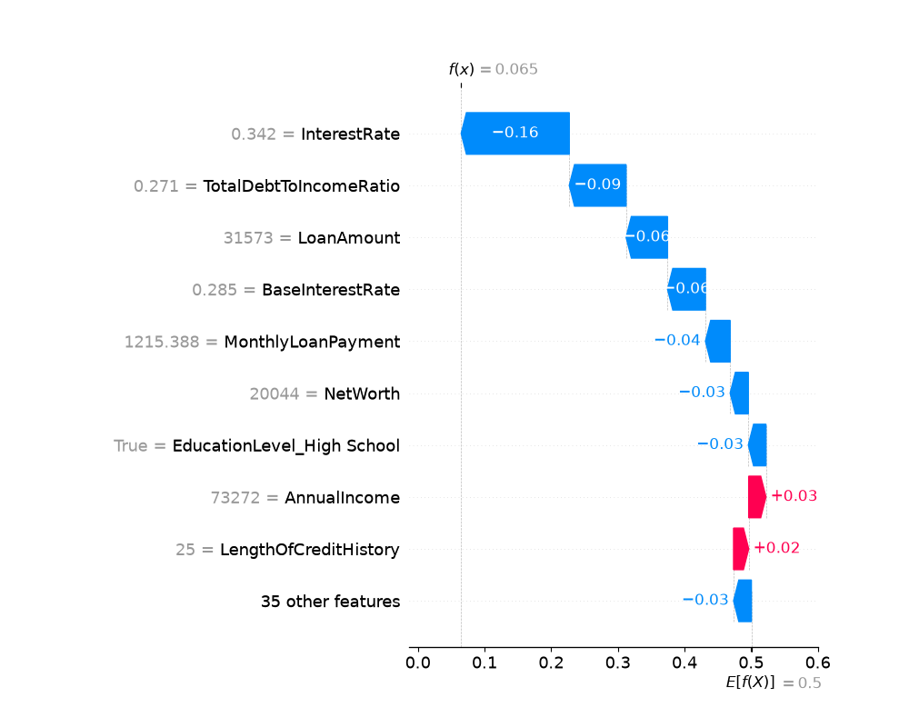

# Credit Risk Assessment with Machine Learning

An end-to-end credit decisioning pipeline in Python: a tuned Random Forest that scores loan applications, explains every decision with SHAP, audits itself for age bias and allocates a fixed lending budget to maximize risk-adjusted return.

*Academic project – MSc Business Mathematics (NKUA & AUEB), course: Machine Learning & AI in Economics and Entrepreneurship.*

## Business problem

Every lending decision carries two costs:
- **Wrongly rejecting** a creditworthy applicant: lost interest income (opportunity cost)
- **Wrongly approving** a weak applicant: lost capital (default risk)

The goal is to replace judgment-based approvals with a data-driven model that is **accurate, explainable, fair and capital-aware**.

## Data

- [Financial Risk for Loan Approval](https://www.kaggle.com/datasets/lorenzozoppelletto/financial-risk-for-loan-approval) (Kaggle, synthetic): **20,000 applications, 33 variables**
- Target: `LoanApproved` (approx. 3 rejections for every approval)
- `RiskScore` removed to prevent **data leakage**
- One-hot encoding (33 → 44 features), standardization, 80/20 train/test split

## Methodology

| Step | Technique |
|---|---|
| Class imbalance | Cost-sensitive learning (`class_weight='balanced'`) |
| Tuning | `GridSearchCV`, 5-fold cross-validation, macro-F1 scoring (best: 200 trees, max depth 20) |
| Evaluation | Confusion matrix, precision/recall, ROC–AUC |
| Explainability | Global feature importance + **SHAP** waterfall for an individual rejected applicant |
| Fairness | **Disparate Impact Ratio** vs. the four-fifths (80%) rule, by age group |
| Capital allocation | Expected profit per loan from model probabilities → ROI ranking → greedy allocation under a €1M budget |

## Results (hold-out test set, 4,000 applications)

| Metric | Value |
|---|---|
| ROC–AUC | **0.98** |
| Accuracy | **92.2%** |
| Recall on creditworthy applicants | **79% → 88%** after cost-sensitive tuning |
| High-risk applications correctly rejected | 2,786 |
| Bad loans approved (false positives) | 197 |



**Key driver:** Total Debt-to-Income ratio (DTI) is the single most important feature, ahead of annual and monthly income. What an applicant already owes matters more than what they earn.

### Explainability – why was this applicant rejected?



A high requested interest rate and a borderline DTI pushed this application below the approval threshold, while a long credit history partially offset them. Explanations like this one support transparency requirements for adverse credit decisions.

### Fairness audit

| Group | Approval rate |
|---|---|
| Age < 30 | 16.3% |
| Age ≥ 30 | 30.3% |
| **Disparate Impact Ratio** | **0.54** (threshold: 0.80) |

The model **fails the four-fifths rule**: it inherits historical bias against younger applicants and would require remediation (re-weighting, threshold adjustment or feature review) before production use.

### Portfolio optimization

From a sample of 100 new applications and a **€1,000,000** lending budget, the allocation approved **15 loans (€237,156)** with an **expected risk-adjusted net profit of €31,734**. Some applicants with good profiles were declined because their return did not justify the risk.

## Limitations

- The target is loan *approval*, not observed *default*, so the approval probability acts as a proxy for PD.
- Expected profit assumes **LGD = 100%** and no separate EAD model. A Basel/IFRS 9-style extension would model PD, LGD and EAD separately.
- The data is synthetic, so the results show the method and are not a production benchmark.

## How to run

```bash
pip install -r requirements.txt
# download Loan.csv from Kaggle into this folder
python credit_risk_model.py
```
Charts are saved to `images/`.

## Tech stack
Python · pandas · NumPy · scikit-learn · SHAP · matplotlib · seaborn
